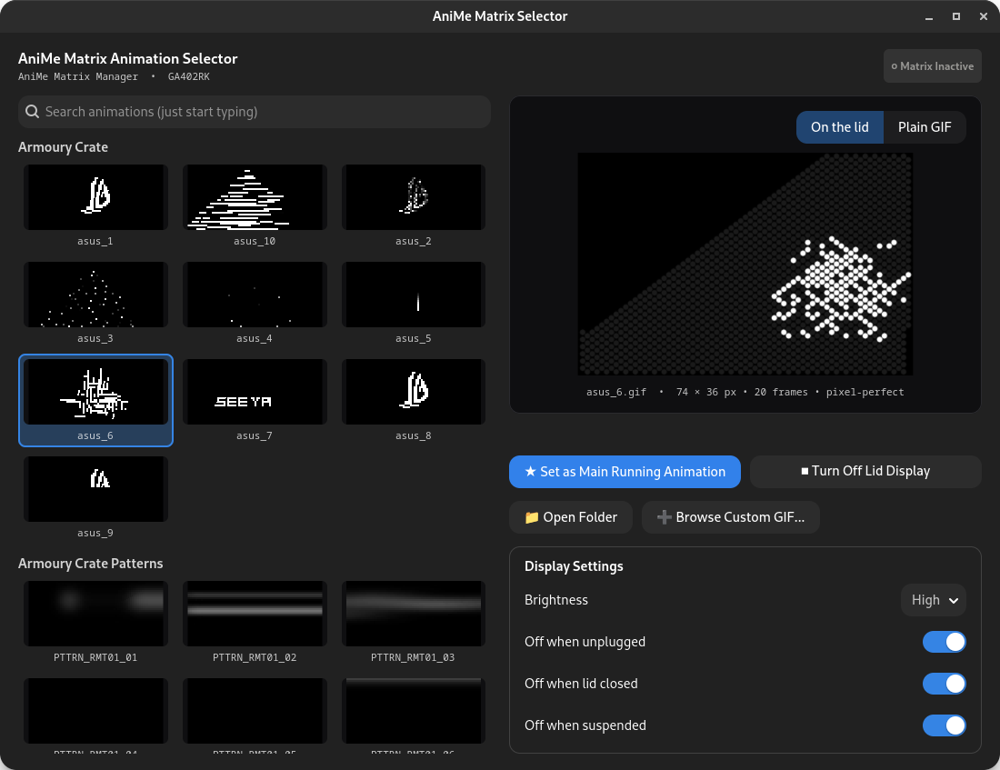

# AniMe Matrix Selector

[](https://github.com/AgonXhaferi/anime_matrix_g14/actions/workflows/ci.yml)

A small GTK 4 app for picking the animation on the AniMe Matrix lid display of ASUS ROG
laptops, on top of [asusctl](https://gitlab.com/asus-linux/asusctl) 6 or newer. Made for
and tested on a Zephyrus G14 GA402RK; it should also work on the other AniMe models asusd
supports (GA401, GU604), without the lid preview there (see below).



This is an independent project, not made or endorsed by ASUS. ROG, Zephyrus and AniMe
Matrix are ASUS trademarks.

## Features

- A grid of animated thumbnails from asusd's stock GIF folder, the Armoury Crate animations
  (optional download, see below), any folders you list in `folders.conf`, the bundled
  Originals and any GIF you add with *Browse*, grouped by folder.
  Start typing anywhere to search by name or category. The playing animation has a green
  outline, and the window opens on it.
- *Set as Main* plays your pick on the lid, on a loop, and keeps playing it after reboots.
  *Turn Off* blanks the display until you pick an animation again.
- An *On the lid* preview that simulates the GA402's 1,449 LEDs as seen from outside the
  lid, using asusctl's own geometry and sampling. *Plain GIF* shows the file itself.
- *Display Settings*: asusd's brightness and "off when unplugged / lid closed / suspended"
  options, changed instantly and kept in sync when changed elsewhere (e.g. `asusctl`).
- *Originals*: twelve animations drawn for the GA402 lid by `animations/make_animations.py`
  (Wizard vs Dragon, Hyperspace, Digital Rain, Inferno, Thunderstorm, Space Battle,
  Heartbeat, Plasma, Ripples, Equalizer, and two Dark Souls scenes: Praise the Sun and
  Siegmeyer Napping).
- *Armoury Crate*: the 22 animations from ASUS's Windows app (its AniMe Matrix library, the
  Patterns and the Alan Walker collection), which asusd doesn't ship. They're kept in a
  [separate repo](https://github.com/AgonXhaferi/anime_matrix_animations) since they're
  ASUS's; `install.sh` offers to download them.

## Requirements

- An ASUS laptop with an AniMe Matrix display, and `asusctl`/`asusd` **6.0 or newer**
  with asusd running. See [asus-linux.org](https://asus-linux.org) for how to install it
  on your distro.
- systemd (the animation keeps playing through a systemd user service).
- Python 3 with **GTK 4.12 or newer** and Pillow:

| Distro | Packages |
|---|---|
| Fedora 39+ | `sudo dnf install python3-gobject gtk4 python3-pillow` |
| Arch, Manjaro | `sudo pacman -S python-gobject gtk4 python-pillow` |
| Debian 13+, Ubuntu 24.04+ | `sudo apt install python3-gi gir1.2-gtk-4.0 python3-pil` |

Older releases (e.g. Ubuntu 22.04, Debian 12) ship GTK older than 4.12, which the app
doesn't support; it says so and exits.

## Install

```sh
git clone https://github.com/AgonXhaferi/anime_matrix_g14.git
cd anime_matrix_g14
./install.sh
```

The installer asks whether to also download the Armoury Crate animations into
`~/.local/share/anime-matrix/armoury-crate` (answer ahead with `--with-armoury-crate` or
`--without-armoury-crate`). Then open *AniMe Matrix Selector* from your app menu, or run
`anime-matrix-selector`.

This installs for your user only and runs the app from the cloned folder (`~/.local/bin`
gets a link to it), so a `git pull` updates it. Re-run `./install.sh` after pulling to pick
up changes to the service or launcher (this also updates the Armoury Crate animations). The installer fills in where asusctl lives and warns
if anything is missing or too old.

| Command | What it does |
|---|---|
| `./install.sh --uninstall` | Stops the animation and removes the app, service, launcher, icon and downloaded Armoury Crate animations. Your settings are kept. |
| `sudo ./install.sh --prefix /usr/local` | Installs a copy for all users. Undo with the same command plus `--uninstall`. |
| `DESTDIR=pkg ./install.sh --prefix /usr` | Stages the files into `pkg/` for building a distro package. |

Installs with `--prefix` don't download the Armoury Crate animations; to add them for all
users, clone [their repo](https://github.com/AgonXhaferi/anime_matrix_animations) into
`/usr/share/anime-matrix/armoury-crate` (or `/usr/local/share/…`).

## How it works

- *Set as Main* points `active.gif` in the config folder at your pick and restarts
  `anime-matrix.service`, a systemd user service that plays it with `asusctl` on a loop.
- GIFs drawn for the native 74×36 LED grid play pixel-perfect (`asusctl anime pixel-gif`);
  any other size is scaled to fit (`asusctl anime gif`). The choice is saved in `mode.env`.
  On a GA402, 74×39 (its full diagonal grid) is native too.
- The lid preview follows asusctl 6.3.8's geometry and sampling (diagonal mapping for native
  GIFs, 16-sample averaging for scaled ones), so it shows what each LED will actually do.
- The model is read from the board name (`/sys/class/dmi/id/board_name`). On anything but a
  GA402 the lid preview is hidden, since other lids lay out their LEDs differently, and the
  Originals are labelled as made for the GA402. At start the app checks that asusctl is
  installed and new enough.
- Thumbnails load only when scrolled into view, keep at most 120 frames each, and pause
  while the window isn't focused, to keep memory and battery use down.
- Each Original is drawn in millimetres as the lid is seen from outside, and every LED takes
  the brightness under its physical position, so they play pixel-perfect, the right way up
  and without stretching. Edit a scene and run `python3 animations/make_animations.py` to
  regenerate them (needs only Pillow).

## Settings

Settings live in `$XDG_CONFIG_HOME/anime-matrix/` (usually `~/.config/anime-matrix/`):

| File | Purpose |
|---|---|
| `folders.conf` | Extra GIF folders to show, one per line, optionally named: `My GIFs = ~/Pictures/lid` |
| `custom-gifs.txt` | GIFs added with *Browse*, one path per line |
| `active.gif` | Link to the animation currently playing |
| `mode.env` | `pixel-gif` or `gif`, written by the app for the service |

## Tested on

| Laptop | Distro | asusctl | GTK |
|---|---|---|---|
| ROG Zephyrus G14 GA402RK | Fedora 44, GNOME 50 | 6.3.8 | 4.22 |

Reports from other models are welcome; please include `cat /sys/class/dmi/id/board_name`.

## Development

```sh
python3 -m unittest discover tests    # geometry, config and backend checks, no hardware needed
python3 -m anime_matrix_selector      # run from the checkout without installing
```

| Path | What's in it |
|---|---|
| `anime_matrix_selector/config.py` | Paths, lid model detection, `folders.conf`, which GIFs to show |
| `anime_matrix_selector/lid.py` | GA402 LED geometry and the lid preview renderer (no GTK) |
| `anime_matrix_selector/backend.py` | Driving the lid through asusctl and the systemd user service |
| `anime_matrix_selector/asusd.py` | asusd's brightness and power settings over D-Bus |
| `anime_matrix_selector/ui/` | The GTK 4 window: library, preview, settings card, `style.css` |
| `animations/` | The Originals and their generator |
| `anime-matrix-selector` | Small launcher that `install.sh` links into your `PATH` |

## Credits and license

The code and the Originals are released under the [MIT License](LICENSE).

The *On the lid* preview's LED geometry and sampling are ported from
[asusctl](https://gitlab.com/asus-linux/asusctl) 6.3.8 (`rog-anime/src/image.rs` and
`diagonal.rs`, MPL-2.0) by Luke Jones and the asus-linux contributors, so the preview
matches what asusctl sends to each LED. asusctl and asusd themselves are not bundled; the
app runs the ones installed on your system.

No ASUS animations are included in this repo. The app reads asusd's stock ones from
asusd's own folder, and the Armoury Crate ones from their
[separate repo](https://github.com/AgonXhaferi/anime_matrix_animations) if you download
it; they belong to ASUS and are not covered by this repo's license.
*Praise the Sun* and *Siegmeyer Napping* are fan art of characters from FromSoftware's
*Dark Souls*, which belong to FromSoftware and Bandai Namco.
